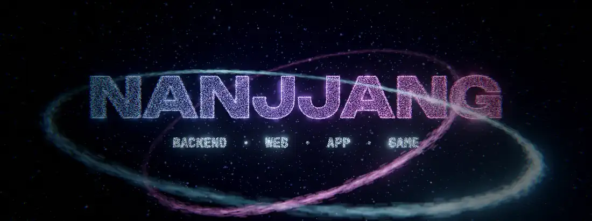

<div align="center">

<a href="https://nanjjang.github.io/nanjjang/">
  
</a>

<sub>▲ 입자 약 9만 개가 은하로 흩어졌다가 이름으로 다시 모입니다 · 클릭하면 마우스로 직접 만져볼 수 있는 <b>라이브 3D</b>가 열려요</sub>

<br />
<br />

[](https://git.io/typing-svg)

<p>
  <a href="https://nanjjang.github.io/nanjjang/">
    
  </a>
  <a href="https://github.com/nanjjang">
    
  </a>
  
  
  
</p>



</div>

<div align="center">
  
</div>

```text
booting profile...

user      nanjjang
mode      student developer
stack     Python / TypeScript / Swift / Svelte
interest  backend, web, app, automation, game dev
status    building, breaking, fixing, learning
```

## About Me

> 아이디어를 **실제로 동작하는 서비스**로 만드는 학생 개발자입니다.
> 백엔드부터 웹·앱까지 직접 설계하고, 배포까지 끝내는 것을 목표로 합니다.

| 🎯 Focus | ⚡ Strength | 🌱 Learning |
| :---: | :---: | :---: |
| Backend API & Automation | 빠른 프로토타이핑 → 실서비스 | System Design · Cloud · AI |

## Now

- 공학/산업 분야 대회 프로젝트를 개발 중입니다.
- FastAPI 서버, Svelte 웹, Swift 앱을 주로 만집니다.
- 필요한 기능을 직접 만들어보면서 공부합니다.
- 작게 시작해서 실제로 굴러가는 결과물을 만드는 걸 좋아합니다.

## Tech Orbit

<div align="center">



</div>

## Project Console

<div align="center">

<a href="https://github.com/nanjjang/AOT">
  
</a>
<a href="https://github.com/nanjjang/2026-Engineering-Industry-Contest">
  
</a>
<a href="https://github.com/nanjjang/uhak-web">
  
</a>
<a href="https://github.com/nanjjang/digital_mental_medicalAI">
  
</a>

</div>

## Build Map

| Area | Tools | Projects |
| --- | --- | --- |
| Backend | Python, FastAPI | API, automation, utilities |
| Web | Svelte, TypeScript, HTML/CSS | dashboards, service pages |
| App | Swift | iOS experiments |
| Game | Unity, C# | 3D action game, small prototypes |

## GitHub Lab

<div align="center">


<br />


<br />


<br />


</div>

## Contribution Snake

<div align="center">

<picture>
  <source media="(prefers-color-scheme: dark)" srcset="https://raw.githubusercontent.com/nanjjang/nanjjang/output/github-snake-dark.svg" />
  
</picture>

</div>

## Contact

<div align="center">

<a href="https://github.com/nanjjang"></a>
<a href="https://github.com/nanjjang?tab=repositories"></a>

</div>

<br />

<div align="center">


</div>

<details>
<summary><sub>🛠 이 3D 히어로는 어떻게 만들었나요?</sub></summary>

<br />

- **씬** — [`docs/scene.js`](docs/scene.js): three.js, 입자 9만 개를 GPU 버텍스 셰이더에서 모핑(은하 ⇄ 글자). 모든 값이 시간 `t`의 순수 함수라서 프레임이 결정적이고 루프가 이음새 없이 이어집니다.
- **README용 영상** — [`scripts/capture_hero.py`](scripts/capture_hero.py): Playwright로 프레임을 뽑고, 서브프레임을 선형 광량으로 평균해 모션블러를 넣은 뒤 `assets/hero.webp`로 인코딩합니다.
- **라이브 버전** — [`docs/index.html`](docs/index.html): 같은 씬을 실시간으로. 마우스 반발장, 클릭 충격파, 드래그 오빗.
- **SVG** — [`scripts/gen_svgs.py`](scripts/gen_svgs.py): README에선 JS가 안 돌아서, 궤도·웨이브는 `cubic-bezier(.37,0,.63,1)` alternate 애니메이션(= 사인파)만으로 만든 순수 CSS 3D입니다.

</details>
